# 科研项目管理
新系统科研项目管理主要用于广纺院承担科研项目立项后内部管理工作，主要涉及日常项目管理、经费管理、成果管理，不涉及对外上报材料（立项审批、中期报告、结题审批等）。

## 1.面积信息管理
### 1.1功能描述
### 1.2权限说明

| 角色      | 权限          |
| ------- | ----------- |
| 技术部管理人员 | 新增/修改/删除/查询 |
| 普通用户    | 查询          |
注：具体角色映射以系统统一权限配置为准。
### 1.3页面与交互说明
#### 1.3.1列表页

- **查询条件：** 部门名称
- **全局操作按钮：** 新增、修改、删除、导入、导出
- **行级操作按钮：** 

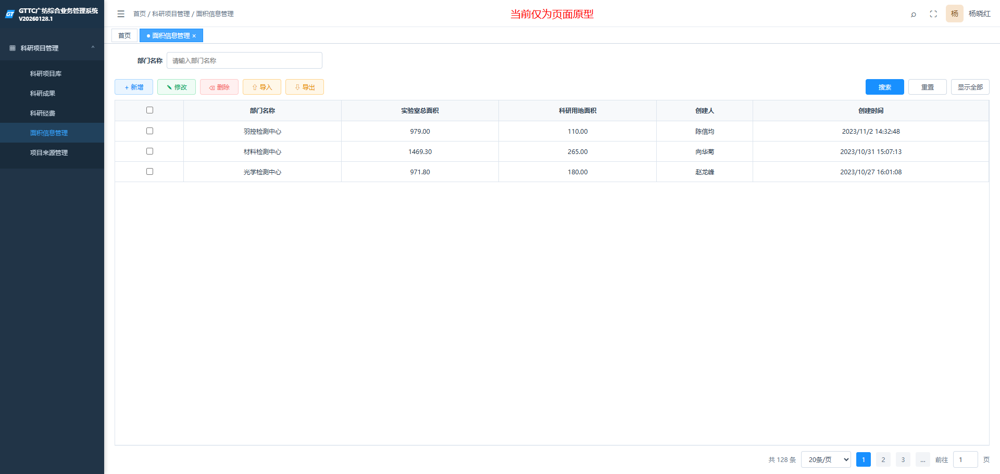

#### 1.3.2新增页
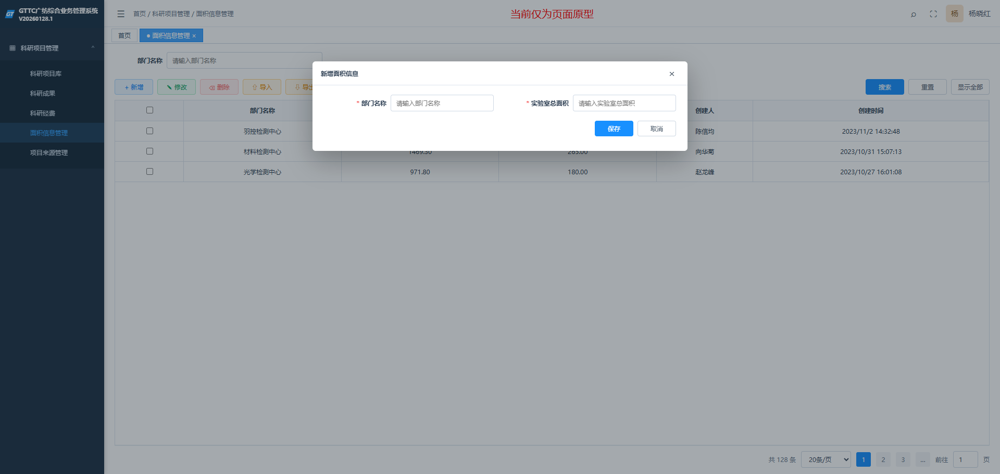
### 1.4数据字典

| 字段     | 类型  | 必填  | 交互方式  | 备注                  |
| ------ | --- | --- | ----- | ------------------- |
| 部门名称   |     | 是   | 级联选择器 | 数据来源于综合管理-人力资源-组织管理 |
| 实验室总面积 |     | 是   |       |                     |
| 科研用地面积 |     |     | 只读    | 系统自动计算              |
### 1.5业务规则
- 科研用地面积统计科研项目库中状态为在研、即将到期的项目对应部门的用地面积。

## 2.项目来源管理
### 2.1功能描述

### 2.2权限说明
| 角色       | 权限  |
| -------- | --- |
| 技术部科研管理员 | ALL |
| 普通用户     | 查询  |
注：具体角色映射以系统统一权限配置为准。
### 2.3页面与交互说明
#### 2.3.1列表页
- **查询条件：** 项目来源名称
- **全局操作按钮：** 新增、修改、删除、启用、停用
- **行级操作按钮：** 

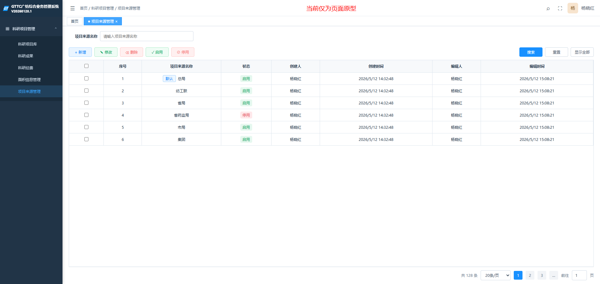
#### 2.3.2新增页
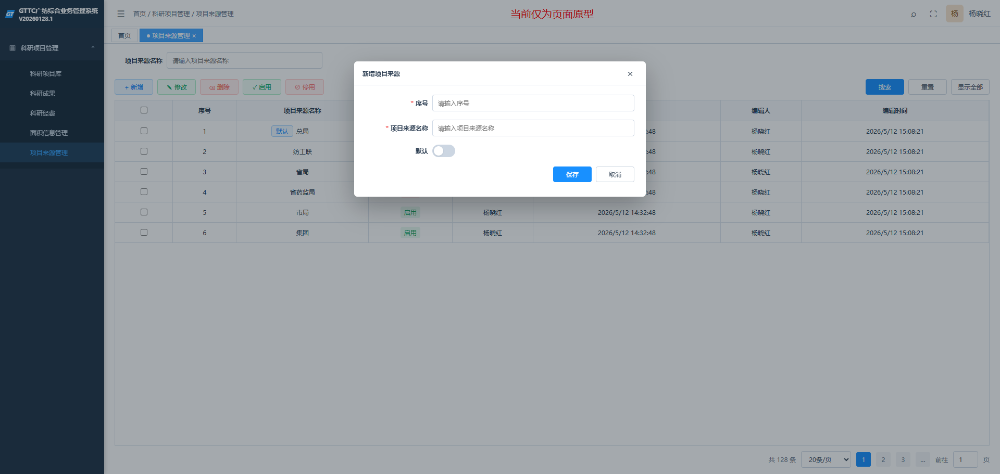
### 2.4数据字典

| 字段     | 类型  | 必填  | 交互方式 | 备注     |
| ------ | --- | --- | ---- | ------ |
| 项目来源名称 |     | 是   |      |        |
| 序号     |     |     |      | 决定选项排序 |
| 状态     |     |     |      | 决定是否可用 |
| 是否默认   |     |     |      |        |
### 2.5业务规则
- 只能存在一个默认值，设置新的默认值后，原默认值自动取消。
- 启用状态限制删除。
## 3.科研项目库
### 3.1功能描述
### 3.2权限说明
| 角色       | 权限             |
| -------- | -------------- |
| 技术部科研管理员 | ALL            |
| 普通用户     | 查询数据及编辑“实际成果”列 |

注：具体角色映射以系统统一权限配置为准。
### 3.3页面与交互说明
#### 3.3.1列表页
- **查询条件：** 项目编号、项目名称、承担部门、项目负责人、项目组成员、项目组内部成员、项目来源、开始日期、截止日期、变更、项目状态、合作单位、项目总经费、已使用经费占比、预期成果、实际成果、验收时间、鉴定时间、备注、资助单位、资助金额（元）、项目所属
- **全局操作按钮：** 新增、修改、删除、导入、导出
- **行级操作按钮：** 
- **列表字段：** 数据字典所有。
- **交互说明：** 点击项目名称或项目编号，可进入项目查看页。

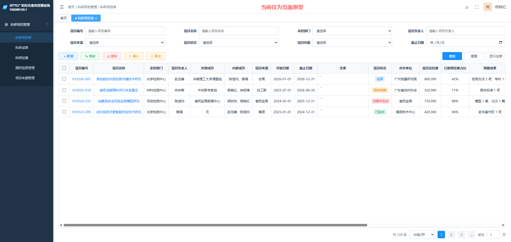
#### 3.3.2新增页
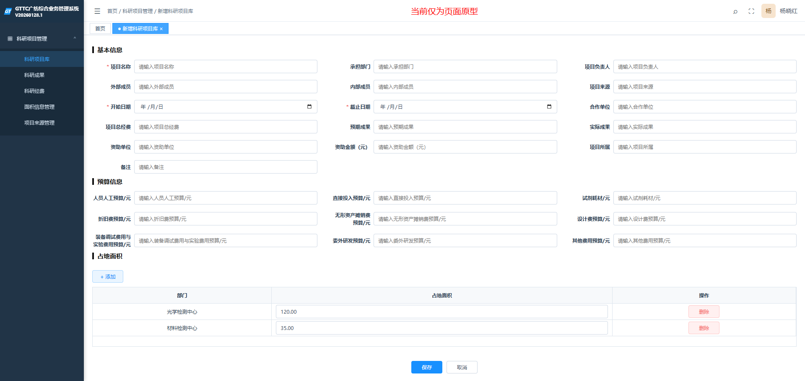

#### 3.3.3详情页
- **交互说明：** 上方展示基本信息卡片，下方展示多张关联子表，点击标签页可切换。

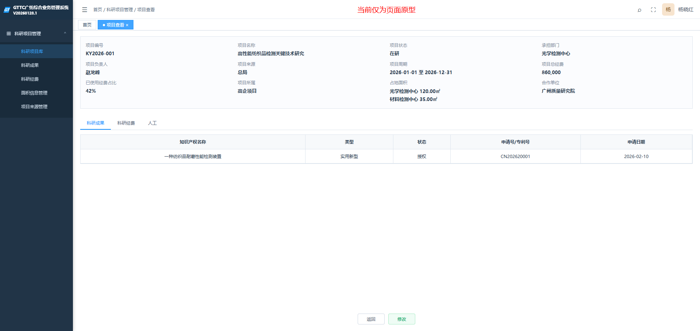
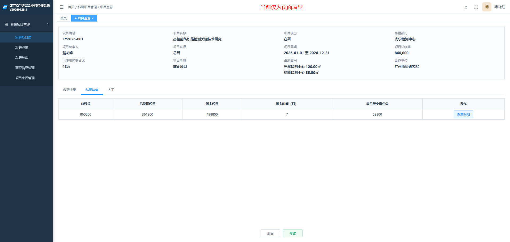

### 3.4数据字典

#### 3.4.1基础信息

| 字段                          | 类型    | 必填 | 交互方式                                   | 备注                                   |
| ----------------------------- | ------- | ---- | ------------------------------------------ | -------------------------------------- |
| 项目编号                      |         |      |                                            | 自动生成                               |
| 项目名称                      |         | 是   |                                            |                                        |
| 承担部门                      |         |      | 级联选择器                                 | 数据来源于综合管理-人力资源-组织管理   |
| 项目负责人                    |         |      |                                            | 数据来源于综合管理-人力资源-人员管理   |
| 外部成员                      |         |      | 手动输入                                   |                                        |
| 内部成员                      |         |      | 下拉选择/搜索                              |                                        |
| 项目来源                      |         |      | 下拉选择                                   | 数据来源于项目来源管理                 |
| 开始日期（必填）              | DATE    |      |                                            |                                        |
| 截止日期（必填）              | DATE    |      |                                            |                                        |
| 变更                          |         |      |                                            |                                        |
| 项目状态                      | TINYINT |      |                                            | 1在研、2即将到期、3到期未验收、4已验收 |
| 合作单位                      |         |      |                                            |                                        |
| 项目总经费                    |         |      |                                            |                                        |
| 已使用经费占比                |         |      |                                            | 来源科研经费                           |
| 预期成果                      |         |      |                                            |                                        |
| 实际成果                      |         |      |                                            |                                        |
| 验收日期                      |         |      |                                            |                                        |
| 鉴定日期                      |         |      |                                            |                                        |
| 备注                          |         |      |                                            |                                        |
| 资助单位                      |         |      |                                            |                                        |
| 资助金额（元）                |         |      |                                            |                                        |
| 项目所属                      |         |      | 下拉选择：高企项目、公共项目               |                                        |
| 占地面积                      | 子表    |      | 表格需要支持动态增行、删行以及行内编辑功能 |                                        |
| 人员人工预算/元               |         |      |                                            |                                        |
| 直接投入预算/元               |         |      |                                            |                                        |
| 试剂耗材/元                   |         |      |                                            |                                        |
| 折旧费预算/元                 |         |      |                                            |                                        |
| 无形资产摊销费预算/元         |         |      |                                            |                                        |
| 设计费预算/元                 |         |      |                                            |                                        |
| 装备调试费用与实验费用预算/元 |         |      |                                            |                                        |
| 委外研发预算/元               |         |      |                                            |                                        |
| 其他费用预算/元               |         |      |                                            |                                        |
#### 3.4.2占地面积

| 字段   | 类型  | 必填  | 交互方式  | 备注                   |
| ---- | --- | --- | ----- | -------------------- |
| 部门   |     |     | 级联选择器 | 数据来源于综合管理-人力资源-组织管理  |
| 占地面积 |     |     | 手动输入  | 用于回填面积信息管理中的"科研用地面积" |

### 3.5业务规则

- **项目状态自动更新**
  
    - **触发机制**：每日 00:00 定时任务或保存触发。
      
    - **计算逻辑**：
      
        1. 若验收日期非空，则状态 = **已验收**。
           
        2. 当前日期 > 截止日期，则状态 = **到期未验收**。
           
        3. (截止日期 - 当前日期) <= 3个月，则状态 = **即将到期**。
           
        4. 其他情况为**在研**。

## 4.科研成果
### 4.1功能描述
### 4.2权限说明
| 角色      | 权限       |
| ------- | -------- |
| 技术部科研管理员 | 新增/修改/删除 |
| 普通用户    | 查询       |
注：具体角色映射以系统统一权限配置为准。
### 4.3页面与交互说明
#### 4.3.1列表页
- **查询条件：** 产权名称，产权类型，发明人，状态，专利权人，代理机构，申请号/专利号，申请日期，授权日期，终止日期。（支持日期范围：起始日期 - 结束日期）
- **全局操作按钮：** 新增，修改，删除，导入，导出
- **行级操作按钮：** 
- **列表字段：** 数据字典所有。
- **交互说明：** 点击项目名称或项目编号，可进入项目查看页

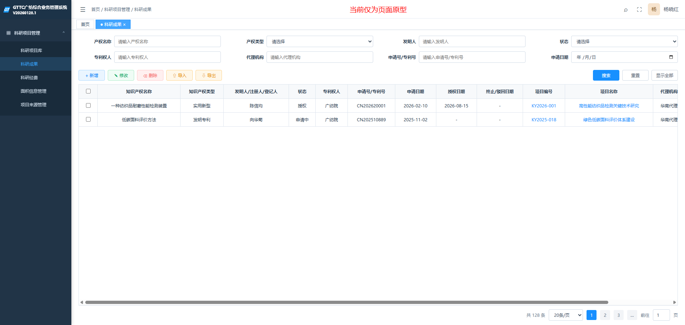
#### 4.3.2新增页
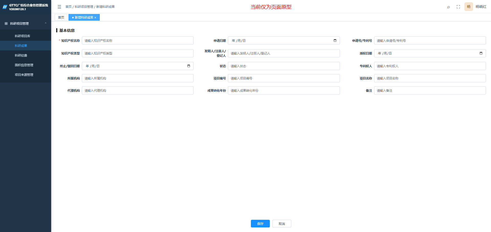
### 4.4数据字典

| 字段                 | 类型    | 必填 | 交互方式 | 备注                                                         |
| -------------------- | ------- | ---- | -------: | :----------------------------------------------------------- |
| 知识产权名称         |         | 是   |          |                                                              |
| 申请日期             |         |      |          |                                                              |
| 申请号/专利号        |         |      |          |                                                              |
| 知识产权类型         | TINYINT |      |          | 1发明专利、2实用新型专利、3软件著作、4标准、5论文、6设备、7其他 |
| 发明人\注册人\登记人 |         |      |          |                                                              |
| 授权日期             |         |      |          |                                                              |
| 终止/驳回日期        |         |      |          |                                                              |
| 状态                 | VARCHAR |      |          |                                                              |
| 专利权人             |         |      |          |                                                              |
| 所属机构             |         |      |          |                                                              |
| 项目编号             |         |      |          |                                                              |
| 项目名称             |         |      |          |                                                              |
| 代理机构             |         |      |          |                                                              |
| 成果转化年份         |         |      |          |                                                              |
| 备注                 |         |      |          |                                                              |

### 4.5业务规则

## 5科研经费
### 5.1功能描述

### 5.2权限说明
| 角色     | 权限    |
| ------ | ----- |
| 科研管理人员 | 导入/导出 |
| 普通用户   | 查询    |
注：具体角色映射以系统统一权限配置为准。
### 5.3页面与交互说明
#### 5.3.1列表页
- **查询条件：** 项目所属、项目编号、项目名称、承担部门/机构、项目负责人、项目来源、项目开始日期、项目截止日期，剩余时间（月）、项目状态、已用经费占比
- **全局操作按钮：** 导入月度明细、导出
- **行级操作按钮：** 查看明细
- **列表字段：** 数据字典所有。
- **交互说明：** 
  - 点击导入月度明细，打开导入窗口，可下载模板，选择年月、附件，执行导入。
  - 点击项目名称或项目编号，可进入项目查看页。
  - 点击查看明细跳转经费详情页。

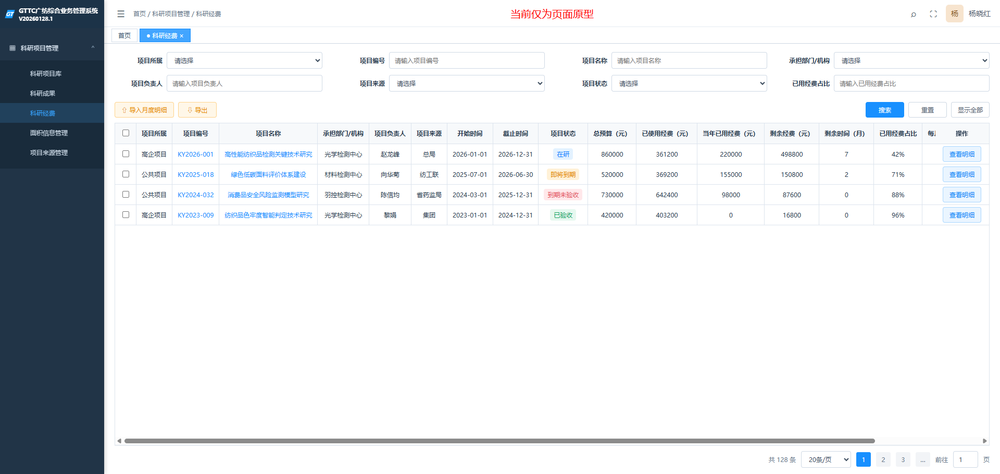
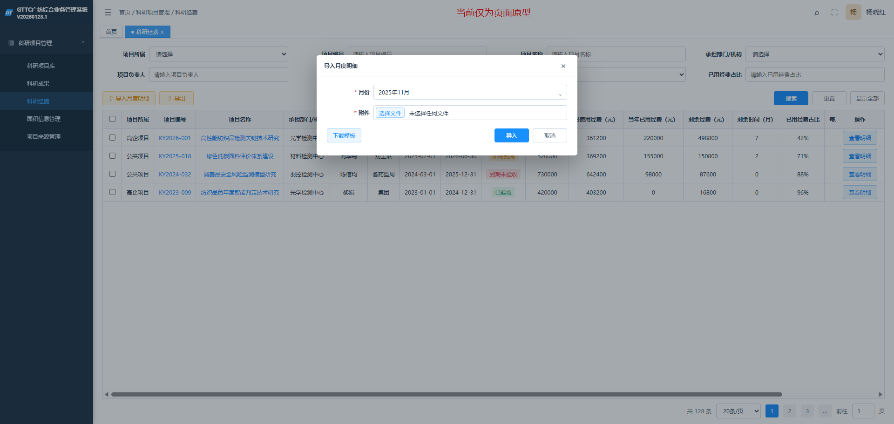
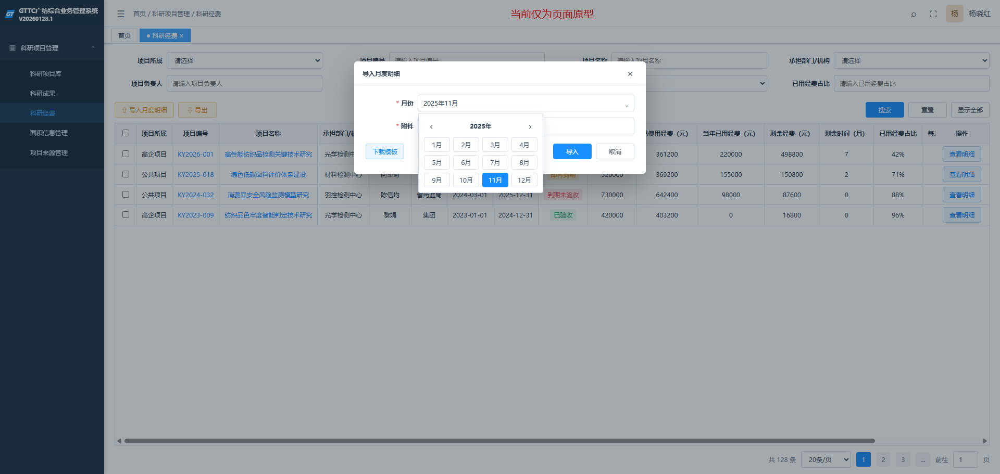
#### 5.3.1详情页（经费明细）
- **基本信息：** 项目编号、项目名称、项目状态、承担部门、项目总经费、已使用经费占比
- **查询条件：** 科目名称、年度
- **全局操作按钮：** 导出
- **行级操作按钮：** 
- **列表字段：** 科目代码、科目名称、科目总预算（元）、【动态年月】、合计
- **交互说明：** 
  - 默认查询当前年度
  - 年度可多选，选中年度所有月份横向拼接，按年度分组并跨列合并（多级表头）
  - 合计为右侧固定列（横向滚动时始终固定在最右侧）
  - 未导入的月份（无数据）不显示

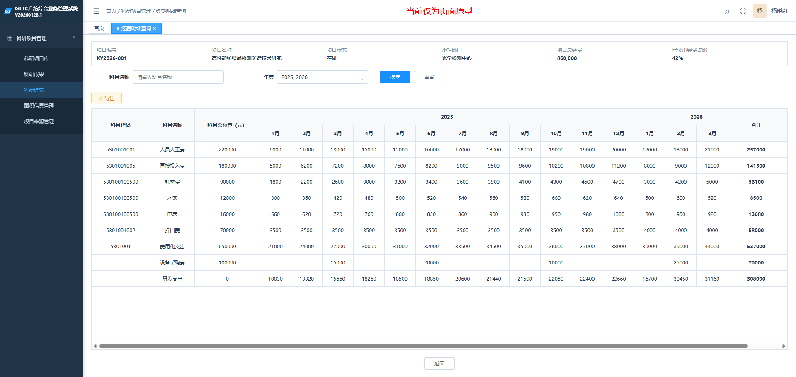
### 5.4数据字典

| 字段        | 类型  | 必填  | 交互方式 | 备注                    |
| --------- | --- | --- | ---- | --------------------- |
| 项目所属      |     |     |      | 来源科研项目库               |
| 项目编号      |     |     |      | 来源科研项目库               |
| 项目名称      |     |     |      | 来源科研项目库               |
| 承担部门/机构   |     |     |      | 来源科研项目库               |
| 项目负责人     |     |     |      | 来源科研项目库               |
| 项目来源      |     |     |      | 来源科研项目库               |
| 开始时间      |     |     |      | 来源科研项目库               |
| 截止时间      |     |     |      | 来源科研项目库               |
| 变更        |     |     |      | 来源科研项目库               |
| 项目状态      |     |     |      | 来源科研项目库               |
| 总预算（元）    |     |     |      | 来源科研项目库               |
| 已使用经费（元）  |     |     |      | 经费明细中“研发支出”经费总和       |
| 当年已用经费（元） |     |     |      | 当前年度经费明细中“研发支出”经费总和   |
| 剩余经费（元）   |     |     |      | 总预算-已使用经费             |
| 剩余时间（月）   |     |     |      | （有效截止日期-当前日期）/30      |
| 已用经费占比（%） |     |     |      | 已使用经费/总预算             |
| 每月至少需归集费用 |     |     |      | （0.85*总预算-已使用经费）/剩余时间 |
| 每月最多需归集费用 |     |     |      | 剩余经费/剩余时间             |
### 5.5业务规则
1. **月度明细导入**：
   
    - 导入月度明细时，需根据“项目编号”自动关联科研项目库。
      
    - **重复校验与处理**：当导入数据的“导入年月”、“项目编号”、“科目代码”、“科目名称”四个字段均相同时，系统需阻断并提示：“已导入重复数据，是否覆盖更新？”。若用户选“是”则覆盖更新数据，选“否”则拒绝导入。
2. **经费明细取值规则**：
   
    - “科研项目总预算”从科研项目库获取对应科目的预算。
      
3. **“研发支出”计算逻辑**：
   - 当经费明细科目为“研发支出”时，需根据“项目来源”动态计算金额：
      
        - 若项目来源为“**集团**”：`研发支出 = 费用化支出`
        - 若项目来源为“**其余参数**”：`研发支出 = 费用化支出 - 人员人工费 - 水费 - 电费 - 折旧费 + 设备采购费`

## 6人工成本

### 6.1功能描述

### 6.2权限说明

| 角色                                     | 权限 |
| ---------------------------------------- | ---- |
| 项目负责人                               |      |
| 普通用户                                 |      |
| 注：具体角色映射以系统统一权限配置为准。 |      |

### 6.3页面与交互说明

#### 6.3.1列表页

- **查询条件：** 月度、部门名称、人员名称、科研工时占比、项目编号、项目名称、项目所属、项目状态、项目来源
- **全局操作按钮：** 新增月度数据、新增、修改、删除、导入、导出
- **行级操作按钮：** 
- **列表字段：** 月度、项目编号、项目名称、姓名、部门、项目工时占比、总科研工时占比
- **交互说明：** 
  - 点击项目名称或项目编号，可进入项目查看页。

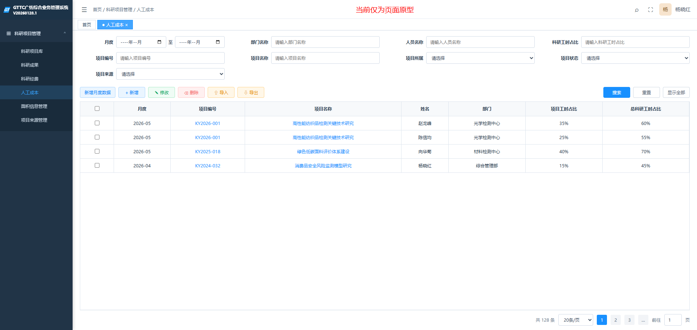

#### 6.3.2新增月度数据

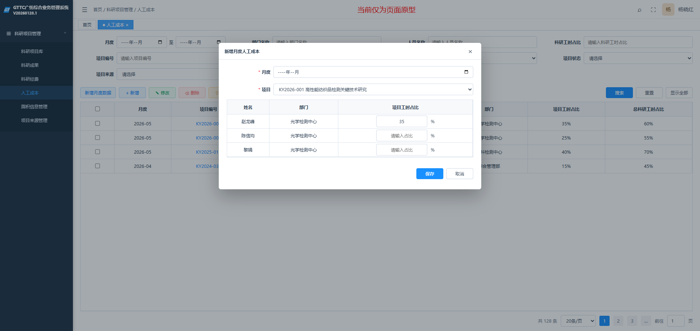

#### 6.3.2新增

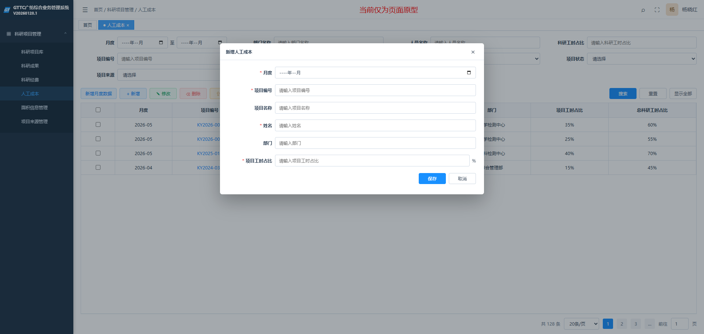
### 6.4数据字典

| 字段  | 类型  | 必填  | 交互方式    | 备注       |
| --- | --- | --- | ------- | -------- |
|     |     |     | 级联选择器   | 数据来源于xxx |
|     |     |     | 下拉选择/搜索 |          |
|     |     |     | 手动输入    |          |
|     |     |     | 多选      |          |

# # 待确认事项清单
| 编号  | 所属模块          | 疑问点描述                                                                                                                 | 结论  | 确认时间 |
| :-: | ------------- | :-------------------------------------------------------------------------------------------------------------------- | --- | ---- |
| Q1  | 科研项目管理-面积信息管理 | 现系统已有综合管理-资产管理-固定资产-资产信息，是否在此添加面积字段即可                                                                                 |     |      |
| Q2  | 科研项目管理-面积信息管理 | 面积单位是？                                                                                                                |     |      |
| Q3  | 科研项目管理-面积信息管理 | 科研项目库中即将到期的是不是也应该算用地面积？                                                                                               |     |      |
| Q4  | 科研项目管理-面积信息管理 | 科研用地面积实时查询，还是加个【更新科研用地面积】按钮（手动更新）+定时任务的方式提高查询效率。                                                                      |     |      |
| Q5  | 科研项目管理-科研项目库  | 项目编号的生成规则                                                                                                             |     |      |
| Q6  | 科研项目管理-科研项目库  | 项目负责人是否为内部人员                                                                                                          |     |      |
| Q7  | 科研项目管理-科研项目库  | 已有内部人员字段，项目成员改成外部人员，只输入外部人员可以吗？                                                                                       |     |      |
| Q8  | 科研项目管理-科研项目库  | 周期变更是只变更截止日期不变更开始日期吗？是否有多次变更，如果有多次变更的话，要对应多行变更发生日期和变更后的截止日期。建议截止日期字段显示变更后的有效截止日期，变更改为变更前截止日期或对应变更记录列表，方便查询还有状态和经费表的计算 |     |      |
| Q9  | 科研项目管理-科研经费   | 剩余时间（月）按（有效截止日期-当前日期）/30即按30天算可不可以                                                                                    |     |      |
| Q10 | 科研项目管理-科研经费   | 科目和科研项目库的字段不能完全对上                                                                                                     |     |      |
| Q11 | 科研项目管理-人工成本   | 科目和费用类别是同一个字段，需统一名称，各类别的数据一致，为什么要筛选？                                                                                  |     |      |
| Q12 |               |                                                                                                                       |     |      |

